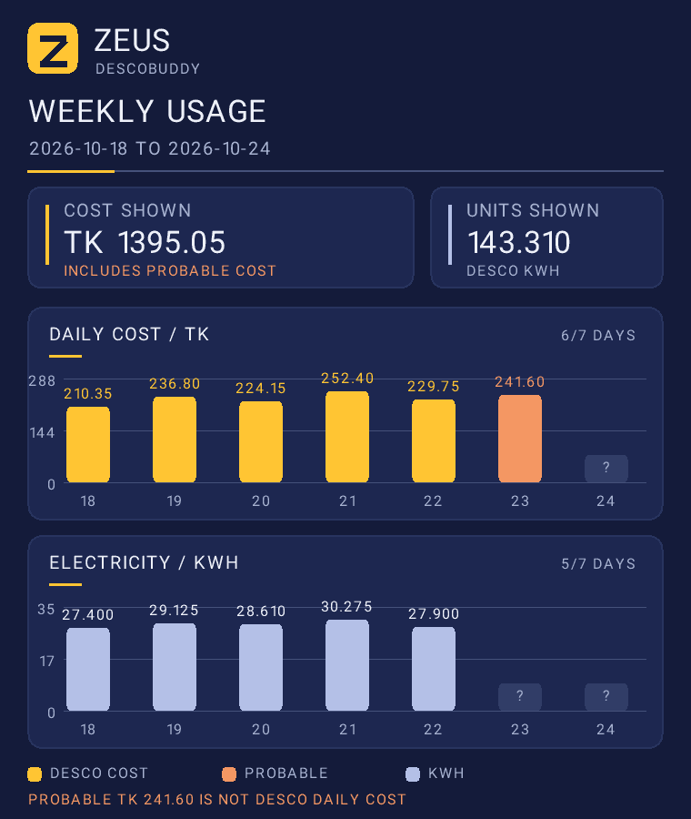

# Zeus DescoBuddy

<picture>
  <source media="(prefers-color-scheme: dark)" srcset="assets/zeus-logo-horizontal-dark.png">
  
</picture>

A Telegram bot for DESCO prepaid meters: check your reported balance, see daily
electricity costs and recharge details, and receive updates when DESCO publishes
new records. The public bot runs in the cloud, so your PC does not need to stay
on.

**[Open @Zeus1810_bot in Telegram](https://t.me/Zeus1810_bot)**

This is an independent community project, not an official DESCO service.

## Get started in Telegram

1. Open the bot and tap **Start**.
2. Find **Account No** and **Meter No** in your DESCO customer information or
   recharge receipt.
3. In a private chat with the bot, send
   `/connect ACCOUNT_NUMBER METER_NUMBER` using your own numbers.
4. Send `/status` for the latest DESCO-reported balance. Use `/help` or the
   buttons beneath the response to explore the other commands.

Each Telegram user connects their **own** account and meter pair. Connect only
a meter you own or are authorized to manage. The pair is checked against DESCO,
but this is not independent proof of legal ownership.

## What the bot shows

| Command                                      | Result                                                                       |
| -------------------------------------------- | ---------------------------------------------------------------------------- |
| `/status`                                    | Latest reported balance, DESCO reading time, and latest available daily cost |
| `/today`                                     | Today's record, or the latest available day while today's is pending         |
| `/week`                                      | Daily kWh and costs for the last 7 days, including today                     |
| `/month`                                     | This month's daily kWh and costs                                             |
| `/graph week`                                | Picture of cost and kWh for the last 7 days, including today                 |
| `/graph month` or `/graph month YYYY-MM`     | Picture of this month or a chosen month                                      |
| `/recharges`                                 | Most recent recharge and its available deductions/credit                     |
| `/history`                                   | Recharge list for the last 35 days                                           |
| `/usage_history` or `/usage_history YYYY-MM` | Recharges and daily costs grouped for a month                                |
| `/audit`                                     | Checks receipt arithmetic and compares available balance records cautiously  |

The charts use Zeus's navy, yellow and lavender palette. Orange means a
**probable** cost estimated from balances, not a DESCO-confirmed daily charge;
`?` means the record has not arrived. The totals count only days with available
values. This sample uses **illustrative data**, not a real meter:



### Where a probable cost comes from

DESCO may publish a new midnight balance before it publishes the matching
daily kWh and official cost. If consecutive balances and recharge credits are
available, the bot can estimate the previous day's deduction:

`previous balance + confirmed net recharge credit − new balance = probable deduction`

For example, if yesterday's balance was ৳1,000, there was no recharge, and the
next reading says ৳780, the bot may show **probable deduction: ৳220**. That is
_not_ a confirmed electricity-only cost: it could include other charges or
adjustments. The bot labels it as probable in messages and graphs, does not
invent missing kWh, and replaces it with DESCO's official daily record when
that arrives. `/audit` can spot arithmetic differences in the records it has;
it cannot prove that a tariff is lawful or that the physical meter is accurate.

Balances and records come from DESCO's online systems. A `/status` request can
fetch the latest available online balance at any time, but it cannot read the
physical meter's live balance between DESCO updates. The bot shows the source
reading time so you can tell how fresh a value is.

## Automatic updates and preferences

By default, the bot looks for newly published DESCO readings and recharges.
It sends a short notice for a new reading, showing the **actual DESCO reading
time** and a probable deduction when the necessary records are available. A
later official daily record normally updates the saved figures without a second
notice; a difference can trigger a follow-up. It also alerts when the reported
balance first crosses **৳500, ৳300, or ৳200**.

Once DESCO has supplied official cost **and** kWh for every day in a completed
Sunday–Saturday week or calendar month, the bot sends one graph for that
period. This can happen after the weekend or month ends if DESCO publishes late.
On-demand graphs can include labelled probable and pending days.

Background checks target roughly 15 minutes per user, but free-tier capacity,
DESCO delays and outages can make updates later. Notices are based on newly
available records, not on an instantaneous meter feed.

| Command                                         | Preference                                                          |
| ----------------------------------------------- | ------------------------------------------------------------------- |
| `/language bn` or `/language en`                | Choose Bangla or English Telegram messages                          |
| `/schedule daily 08:00`                         | Add a daily summary at 08:00 Bangladesh time                        |
| `/schedule weekly fri 20:00`                    | Add a weekly summary on Friday at 20:00                             |
| `/schedule off`                                 | Remove your scheduled summary                                       |
| `/alerts low 600`                               | Add a personal low-balance alert at ৳600                            |
| `/alerts low off`                               | Remove your personal low-balance alert                              |
| `/alerts mismatch on` or `/alerts mismatch off` | Toggle optional receipt-arithmetic alerts                           |
| `/extras off`                                   | Remove your optional schedule and alerts; standard notices continue |
| `/pause` or `/resume`                           | Stop or restart **all** automatic messages                          |
| `/settings`                                     | Show your current preferences                                       |

You can still use commands while automatic messages are paused. Graph image
labels are currently in English; bot text and graph captions follow the chosen
language.

## Data and chat controls

| Command               | Result                                                       |
| --------------------- | ------------------------------------------------------------ |
| `/export`             | Download a JSON copy of your saved readings; keep it private |
| `/clear`              | Try to delete eligible recent messages from this bot chat    |
| `/disconnect confirm` | Remove your connected meter and saved bot data               |

Telegram does not allow a bot to erase an entire old chat. `/clear` can delete
only recent messages within Telegram's limits; use Telegram's **Clear History**
for older messages. `/clear` does **not** delete saved meter data.

Profiles and cached financial records are encrypted in the cloud database, but
messages in Telegram and files you export remain readable wherever you keep
them. The bot does not initiate payments. See [security and privacy](docs/security.md)
for threat boundaries and remaining limits.

## Repository and self-hosting

The active public bot is in [`cloud/`](cloud/), with its [setup, CI/CD and
backup guide](cloud/README.md). The earlier private Python edition is in
[`descobuddy/`](descobuddy/); its [historical setup guide](docs/archive/README-2026-10-04.md)
is separate. Do not run the Python polling bot and the cloud webhook with the
same Telegram token at the same time.

To verify the cloud edition locally, use Node.js 22+:

```sh
cd cloud
npm ci
npm run check
npm test
```

For design and operational details, see the [architecture](docs/architecture.md)
and [security](docs/security.md) guides. DESCO endpoints and free-hosting quotas
can change; uninterrupted service is not guaranteed.
